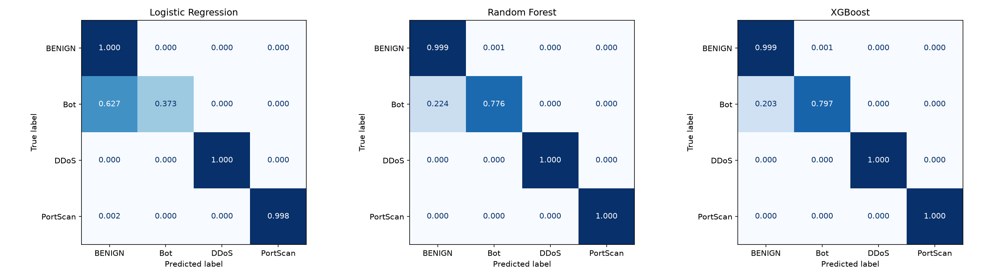
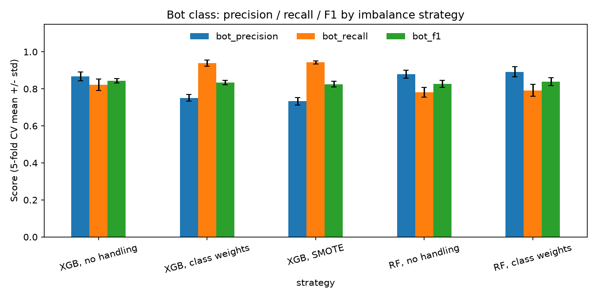
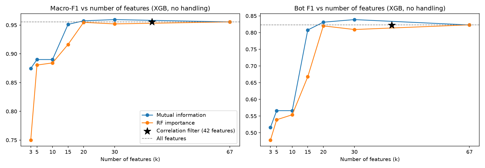

# ml-intrusion-detection

Machine-learning intrusion detection on **CIC-IDS2017**: classifying network flows as
benign or as a specific attack (DDoS, PortScan, Botnet), comparing a linear baseline
with tree ensembles, and studying how **class imbalance** and **feature selection**
affect detection of the rare **Bot** class.

> Status: work in progress. Results tables below are filled in as each stage is completed.

## Why this project

Botnet traffic is usually a tiny fraction of what a network sees. In the Friday
captures of CIC-IDS2017, Bot flows are well under 1% of the data, so a model can score
high accuracy while missing most of them. This project measures that effect directly
and asks how far a small, well-chosen feature subset can go, which matters for
lightweight detectors on constrained (e.g. IoT) devices.

## Data

- Dataset: CIC-IDS2017, `MachineLearningCSV` version (Canadian Institute for Cybersecurity, UNB).
- Subset: Friday captures (3 files): Bot, PortScan, DDoS, and benign traffic.
- The CSVs are **not** in this repository. Download them from the
  [CIC-IDS2017 page](https://www.unb.ca/cic/datasets/ids-2017.html) and place the three
  `Friday-*.csv` files in `data/raw/`.

Known data issues handled in `src/data.py`: stray spaces in column names, `inf`/`NaN`
in `Flow Bytes/s` and `Flow Packets/s`, a duplicated column (`Fwd Header Length.1`),
constant columns, and duplicate rows.

## Project structure

```
data/raw/            original CSVs (git-ignored)
data/processed/      cleaned data (git-ignored)
notebooks/           01_eda -> 02_baseline -> 03_imbalance_and_features
src/data.py          shared loading and cleaning code
reports/figures/     plots used in this README
```

## Roadmap

- [x] Project setup
- [x] 01 Exploratory data analysis
- [x] 02 Baseline models: Logistic Regression, Random Forest, XGBoost
- [x] 03 Class imbalance (class weights, SMOTE) and feature selection
- [x] Results and discussion

## Results

### Data after cleaning

| Class | Raw flows | After cleaning | Share |
|---|---:|---:|---:|
| BENIGN | 414,322 | 394,777 | 64.1% |
| PortScan | 158,930 | 90,694 | 14.7% |
| DDoS | 128,027 | 128,014 | 20.8% |
| **Bot** | 1,966 | 1,948 | **0.32%** |

- 12.4% of all flows were exact duplicates; **43% of PortScan flows** were duplicates.
  Without removing them, identical flows land in both train and test and inflate scores.
- 11 columns carry no information (one duplicated column, ten all-zero columns), leaving 67 features.
- 60 feature pairs have |r| > 0.95, several are identical (e.g. `Total Fwd Packets` and
  `Subflow Fwd Packets`): strong motivation for feature selection.

### Baseline (stratified 80/20 split, 123,087 test flows, 389 of them Bot)

| Model | Accuracy | Macro-F1 | Bot recall | Bot F1 | Train time |
|---|---:|---:|---:|---:|---:|
| Logistic Regression | 0.9975 | 0.8839 | 0.373 | 0.539 | 5 s |
| Random Forest | 0.9989 | 0.9557 | 0.776 | 0.824 | 11 s |
| XGBoost | 0.9989 | 0.9558 | **0.797** | **0.824** | 26 s |



**Takeaway.** All three models exceed 99.7% accuracy, yet Logistic Regression misses 63%
of Bot flows. DDoS and PortScan are almost perfectly separated; **every error that matters is
Bot predicted as BENIGN** (20-22% of Bot flows even for the tree ensembles). Accuracy hides
this completely, which is why the next stage targets Bot recall directly.

### Class imbalance (5-fold CV on the training set, mean ± std per fold)

| Strategy | Bot precision | Bot recall | Bot F1 | Missed bots | False Bot alarms |
|---|---:|---:|---:|---:|---:|
| XGBoost, no handling | 0.867 ± 0.025 | 0.822 ± 0.031 | **0.844 ± 0.012** | 55 | 40 |
| XGBoost, class weights | 0.752 ± 0.019 | 0.939 ± 0.016 | 0.835 ± 0.011 | 19 | 97 |
| XGBoost, SMOTE | 0.734 ± 0.020 | **0.943 ± 0.008** | 0.825 ± 0.015 | **18** | 107 |
| Random Forest, no handling | 0.879 ± 0.022 | 0.781 ± 0.027 | 0.827 ± 0.020 | 68 | 34 |
| Random Forest, class weights | 0.892 ± 0.027 | 0.792 ± 0.033 | 0.839 ± 0.021 | 65 | 30 |



**Takeaway.** Class weights and SMOTE do not make XGBoost *better*; they move it along the
precision-recall trade-off. Bot recall rises from 0.82 to 0.94 (missed bots per fold fall from
55 to 18), while false Bot alarms rise from 40 to about 100. Bot F1 stays the same within one
standard deviation. Which setting is right depends on the deployment: a botnet that goes
undetected is usually costlier than ~100 extra alerts out of ~63,000 benign flows per fold (0.16%),
which argues for the reweighted models in practice even though they do not win on F1.

### Feature selection (XGBoost, features ranked on the training set, scored on the test set)



| Feature set | # features | Macro-F1 | Bot recall | Bot F1 |
|---|---:|---:|---:|---:|
| All features | 67 | 0.955 | 0.800 | 0.823 |
| Correlation filter (\|r\| ≤ 0.95) | 42 | 0.955 | 0.797 | 0.822 |
| Top-20 by mutual information | 20 | 0.957 | 0.715 | 0.831 |
| Top-10 by mutual information | 10 | 0.890 | 0.396 | 0.566 |

**Takeaways.**
- Removing redundant features costs nothing: **42 of 67 features (37% fewer) give the same
  result** as the full set.
- DDoS and PortScan need very few features, but Bot does not. With 10 features or fewer, Bot
  recall collapses below 0.40, and performance only recovers between 15 and 20 features.
- The top-ranked features of both methods are mostly near-copies of one another (packet-length
  means, sizes and sub-flow byte counts). Rankings that score each feature on its own waste the
  first slots on redundant information; redundancy-aware selection (e.g. mRMR) is a natural
  next step, especially for small feature budgets on constrained IoT devices.
- At 20 features Bot F1 is similar, but the balance shifts toward precision: fewer false
  alarms, more missed bots. The differences between 20, 30 and 67 features are within the
  fold-to-fold variation measured above.

### Shortcut check: `Destination Port`

| Features | Macro-F1 | Bot recall | Bot F1 |
|---|---:|---:|---:|
| All 67 | 0.9558 | 0.797 | 0.825 |
| Without `Destination Port` | 0.9543 | 0.787 | 0.818 |

(The full-feature row differs slightly from the feature-selection table because XGBoost's
tie-breaking depends on column order.) Dropping the port costs 4 more missed bots out of 389. The model is learning traffic
behaviour, not the bot's fixed port, which matters for transfer to other networks.

## Limitations and next steps

- Single dataset and single capture day; the Bot class has fewer than 2,000 flows, so per-class
  numbers carry noticeable variance.
- CIC-IDS2017 has documented labelling and feature-extraction errors (Engelen et al., 2021);
  results on a corrected version may differ.
- The split is random rather than time-based, which is optimistic for a deployed detector.
- Next: decision-threshold tuning for Bot, redundancy-aware feature selection (mRMR),
  and testing transfer to an IoT botnet dataset (e.g. N-BaIoT, Bot-IoT).

## How to run

```bash
pip install -r requirements.txt
jupyter notebook notebooks/
```

## References

- I. Sharafaldin, A. H. Lashkari, A. A. Ghorbani, "Toward Generating a New Intrusion
  Detection Dataset and Intrusion Traffic Characterization", ICISSP 2018.
- G. Engelen, V. Rimmer, W. Joosen, "Troubleshooting an Intrusion Detection Dataset:
  the CICIDS2017 Case Study", IEEE SPW 2021.
